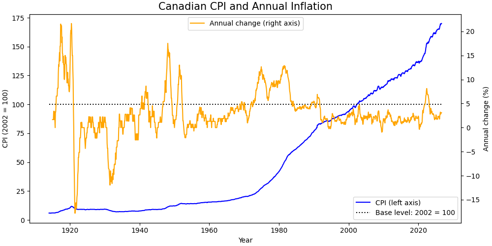

# FINE3300-2026-A2

**INTRODUCTION**

This project uses monthly Canadian CPI data from the Bank of Canada to compare the cost of goods and services between two months. The user enters a price and two dates, and the program calculates the adjusted cost, percentage change, number of years, and average annual rate. It also displays the CPI values used and creates a graph showing Canadian CPI and annual inflation!


**DESCRIPTION OF FILES**

Inflation_Calculator.py
    This is the main code within this folder, a python program that runs the CPI calculator and creates the graph.

CPI.csv
    This file contains monthly Canadian CPI data downloaded from the Bank of Canada

CPI_Graph.png
    The inflation graph saved by the Inflation_Calculator.py python program

README.md
    Starting point: project description, running instructions, graph commentary, and a sample output.


**HOW TO RUN PROGRAM**

Please ensure python3 is installed. Download the project files and keep `Inflation_Calculator.py` and `CPI.csv` in the same folder.

Open a terminal in that folder and install the required libraries: numpy, pandas, matplotlib
```
python3 -m pip install numpy pandas matplotlib
```

Run the program:

```
python3 Inflation_Calculator.py
```

Enter a positive price without dollar signs or commas. Then enter the first and second dates in `YYYY-MM` format, such as `2000-01`. Both dates must be within the available range printed by the program.

Your results appear calculated in the terminal. Simultaneously, the program will open the graph and save it as `CPI_Graph.png`.


**SAMPLE OUTPUT***

For this example, the price entered is `100`, the first date is `2000-01`, and the second date is `2001-01`. It also shows the prompt for the price of goods looping in the event of user input error.
```
Canadian Inflation Calculator
Available dates: 1914-01 to 2026-09
What is the price of goods? (CAD): 
Please type a positive number like 100.50.
What is the price of goods? (CAD): 100
Input first date (YYYY-MM): 2000-01
Input second date (YYYY-MM): 2001-01

A basket of goods and services
Cost in 2000-01: $100.00 CAD
Cost in 2001-01: $102.99 CAD
Percent change: 2.99%
Number of years: 1.00
Average annual rate: 2.99%
CPI for 2000-01: 93.5
CPI for 2001-01: 96.3
```


**GRAPH AND COMMENTARY**


The blue line shows the CPI using the left-hand axis. The orange line uses the right-hand axis and compares each month's CPI with the same month one year earlier. The dotted line marks the base level of 2002 = 100.

You will see the CPI generally rise over the full period, although there are periods when it falls. Annual inflation is especially high during parts of the 1910s and around the 1970s and early 1980s. There are also periods of negative annual inflation, including the early 1920s and early 1930s, when prices were lower than in the same month a year earlier. I found wartime implications most interesting on the graph; the high orange values in the late 1910s align with wartime shortages, pressure on production, and labour shortages that all contributed to rising Canadian prices.

The annual inflation line fluctuates much more than the CPI level. This could be because it shows the rate of change rather than the actual price level. A lower positive inflation rate means prices are still rising, though more slowly.